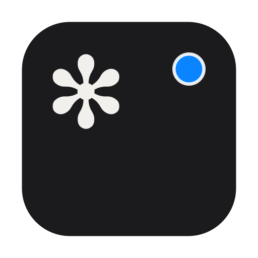
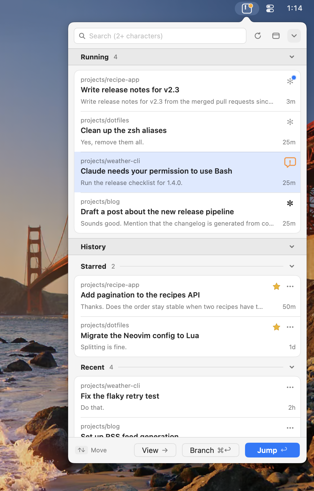
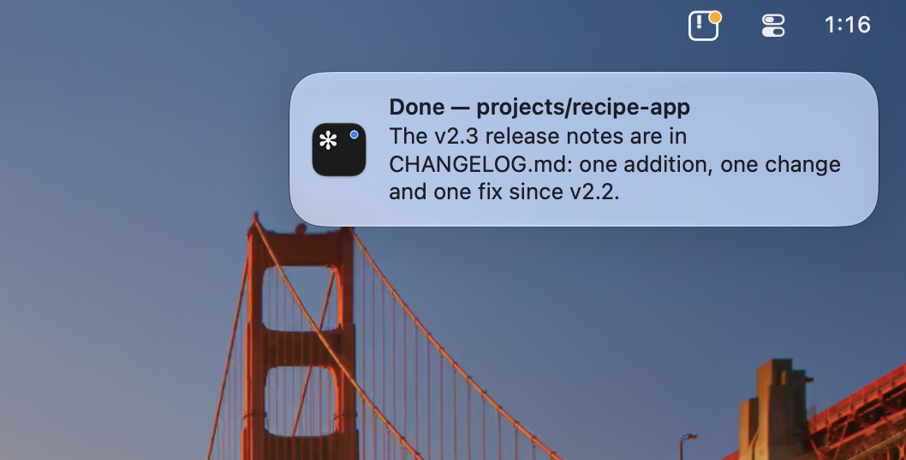
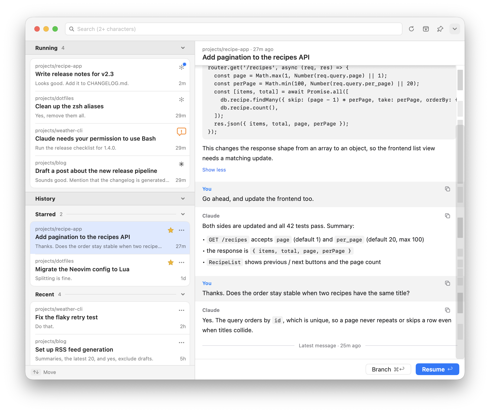
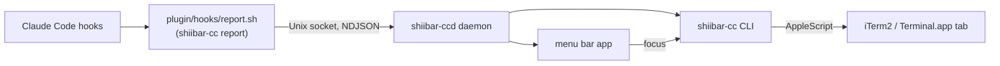

# Shiibar CC



A macOS menu bar app that watches your Claude Code agent sessions
running in iTerm2 or the macOS Terminal.app and lets you jump straight to
the right one.

**Supported terminals only, by design.** Sessions running in a terminal
Shiibar CC can't drive (VS Code's integrated terminal, SSH) are not tracked
at all — they never show up as Running sessions (no status, no
notifications), and there is nothing to jump to. If
your Claude Code sessions don't live in a supported terminal, this tool does
nothing for you.

<br clear="all">

## Supported terminals

Shiibar CC tracks and jumps to Claude Code sessions running in these
terminals:

| Terminal           | Verified with                   |
| ------------------ | ------------------------------- |
| iTerm2             | iTerm2 3.6.11 on macOS 14.5     |
| macOS Terminal.app | Terminal.app 2.14 on macOS 14.5 |

"Verified with" is the combination the behavior was checked against, not a
minimum requirement — lower bounds aren't tested. A session in any other
terminal (VS Code's integrated terminal, SSH) isn't tracked: it never
appears under Running, and there is nothing to jump to. Its conversation
shows in History marked `running`, where you can read or branch it but not
jump to it.

## What it does

Claude Code hooks report each session's state to a small local daemon that
feeds the menu bar app. The tray icon shows a roll-up of every session at
a glance:

- **waiting** — an agent is blocked on you (a permission prompt, a question)
- **working** — an agent is actively running a tool or generating a response
- **idle** — an agent has nothing pending (just started, or finished its work)
- **unreviewed** — a badge that stays lit until you've actually looked at a
  session that finished or started waiting

Click the tray icon and a popover opens under it with one list: the
sessions running right now (**Running**, newest first, each with its status
symbol) and your past Claude Code conversations (**History**). Type to
filter both at once (the × at the right end of the search field clears
it). Click a row to select it (click it again to clear the selection);
the buttons at the bottom act on the selected row, and
double-clicking a row runs its main button directly. On a running
session the main button is **Jump** (it brings up that session's terminal
tab; clicking a notification does the same), and on a past conversation it is **Resume** (it reopens the
conversation in a new terminal window). **Branch**, next to it, starts a
new conversation from a copy of either kind.



Notifications carry the outcome, not just an alert — which session
finished, and what its agent last said:



The keyboard works too. The search field only edits your query; Return
there moves you into the list (selecting the first row if none is
selected), so typing a query and pressing Return twice jumps to or resumes the top
match. Once the list has focus, ↑ / ↓ select a row, Return jumps or
resumes, ⌘Return branches, and → opens the conversation and ← goes back
to the list (in the popover or a narrow window). ⌘F (or a click) takes you
back to the search field, and Esc closes the popover. The hint at the
bottom left shows the keys that work right now. The Jump / Resume and
Branch buttons, with their keys (↩ and ⌘↩), show while the list has focus
and hide while you type in the search field. ⌘R (or the ⟳ button next to
the search field) refreshes the whole list: the running sessions and the
past conversations. The popover is as tall as
you drag its bottom edge, and stays that way. ⌘= and ⌘− make the text
and the rows in the popover and the window larger or smaller, and ⌘0 goes
back to the default size (the same value is in Settings… → General → **Text size**).

**Open in window** (the window button in the popover's header) moves the
same list, with the same search and selection, into an ordinary window that
stays put while you work through it. Widen the window and the selected
conversation shows next to the list; drag the line between the two to
resize the list, and double-click the line to go back to the default
width. Pin the window (the pin button) to keep it in front of other
windows. While the window is open the app shows up in the
Dock with a regular menu bar menu (⌘, opens Settings… — where you can
also switch the appearance between System, Light and Dark).

You can also open the list from the keyboard while another app is in
front. No shortcut is set until you record one: in Settings… → General →
**Global shortcut**, click the field and press the combination you want
(for example ⌃⌥Space). The combination is taken from every app, so pick
one you don't use elsewhere. It needs ⌃, ⌥ or ⌘ unless the key is a
function key (F1–F20). Esc cancels recording, and × removes the shortcut.
Pressing the shortcut opens the popover with the list focused (or the
conversation, if one is open), so ↑ / ↓ and Return work right away;
pressing it again closes the popover. While the window is open, the
shortcut brings the window to the front instead, with the same focus.

### Conversations

Alongside the live status view, Shiibar CC keeps a searchable index of your
Claude Code conversation history across every folder; that index is what
fills the History section. Press the **>** button at the right end of a row
(or select the row and press →) to **read** the conversation from the
bottom (latest) up: in the popover, and in a narrow window, it slides in as
a page of its own; in a wide window there is no **>** button, and the
selected row's conversation shows next to the list. Search is incremental; each word of
two or more characters matches as a case-insensitive substring ("auth" finds
"authentication"), multiple words are AND-ed, and the matches are
highlighted in the conversation (⌘G / ⇧⌘G step through them). Star a
conversation in History to keep it at the top of the section.



The same search is available from scripts, so you don't need the app to
find a conversation:

```sh
shiibar-cc conversations search "auth middleware"   # add --json for a stable
                                                    # machine-readable shape
```

Conversations reads Claude Code's transcripts, an undocumented internal
format; a Claude Code update may break the History section or the
conversation view until Shiibar CC catches up.

## Permissions

Installing and running Shiibar CC asks for the following. Each one maps to a
specific feature — nothing is requested speculatively.

- **Automation (Apple Events) for iTerm2 and Terminal.app**: needed to find
  and select the right window/tab/session when you jump to an agent. Shiibar
  CC drives whichever of the two supported terminals a session runs in, and
  only asks for a terminal's permission when it actually needs to control it.
- **Notifications**: needed to alert you when a session starts waiting on
  you, or finishes.
- **Login Items**: the app registers itself to start at login automatically
  the first time you launch it. You can turn this off any time from the
  app's `⌄` menu (Settings… → General → Start at Login); once you do, the
  app respects that choice and won't re-register itself.
- **Code signing**: the Homebrew cask ships a Developer ID–signed, notarized
  `.app` — no local signing step. Building from source instead signs the
  app locally with a stable self-signed identity created on first install
  (`security` / `codesign`), so that rebuilding it doesn't reset the
  notification permission macOS ties to the app's signature. This only
  applies to the source-build path.
- **Hooks, via a Claude Code plugin**: Shiibar CC needs Claude Code to report
  session events to it. This repository is itself a Claude Code plugin
  marketplace. The Homebrew cask installs the plugin automatically on first
  install (below); either way it's two `claude plugin` commands and it
  coexists with whatever hooks you already have.
- **A state directory** (`~/.local/state/shiibar-cc/`): holds the daemon's
  Unix socket, its persisted session state, its log file, and — for the
  Conversations feature — a local search index (`conversations-index.db`)
  containing the full text of your Claude Code conversations. Nothing here
  leaves your machine, and the directory is safe to delete: the daemon
  recreates its files and the search index is rebuilt on demand.

## Install / Uninstall

### Homebrew (recommended)

**Requirements**: macOS 14 (Sonoma) or later, Apple Silicon, and
[Homebrew](https://brew.sh). Intel Macs are not supported — see the source
build below.

```sh
brew install --cask bufferings/tap/shiibar-cc
```

This installs `Shiibar CC.app` to `/Applications` and symlinks
`shiibar-cc` / `shiibar-ccd` into Homebrew's `bin`. **It also automatically
installs the hooks plugin** on first install (skipped if you disabled or
removed the plugin, or if it can't find the `claude` CLI), and while the
plugin stays enabled, every `brew upgrade` of this cask also updates the
hooks to match the app. If the automatic install doesn't run, install the
plugin yourself:

```sh
claude plugin marketplace add bufferings/shiibar-cc
claude plugin install shiibar-cc@shiibar-cc
```

Then open Shiibar CC once (from Spotlight or `/Applications`) to grant the
notification and terminal Automation permissions — this also registers it as
a Login Item. Verify everything end to end from the popover's ⌄ menu →
Setup Check, or from a terminal:

```sh
shiibar-cc doctor
```

To remove it:

```sh
brew uninstall --cask shiibar-cc   # add --zap to also remove the state
                                   # directory (including the local
                                   # conversations index), saved
                                   # preferences, and saved app state
claude plugin uninstall shiibar-cc
```

Either way, the notification permission itself can't be removed by a
script — macOS ties it to the app, and only System Settings → Notifications
can revoke it.

### Source build (developers)

Building from source is a development setup, not an Intel-Mac substitute
for the Homebrew cask — there is no Intel build, and none is planned (there
is no Intel Mac or CI runner to verify one on).

**Requirements**: macOS 14 (Sonoma) or later, a Rust toolchain via
[rustup](https://rustup.rs) (the pinned version in `rust-toolchain.toml` is
installed automatically), and Xcode Command Line Tools for building the app
(`swift build`). Running the app's own test suite (`swift test`, not
required for normal use) needs the full Xcode.app, not just the CLT.

```sh
git clone <this repo>
cd shiibar-cc
./scripts/dev-install.sh
```

This builds the daemon and CLI, builds and bundles the menu bar app as
`Shiibar CC.app` (installed to `~/Applications` by default), code-signs it
locally, symlinks `shiibar-cc` / `shiibar-ccd` onto `~/.local/bin`, and
launches the app once (which registers it as a Login Item and starts the
daemon). It then prints the two commands to install the hooks plugin, and
points you at `shiibar-cc doctor` to verify everything end to end:

```sh
claude plugin marketplace add bufferings/shiibar-cc
claude plugin install shiibar-cc@shiibar-cc
```

To remove it:

```sh
./scripts/dev-uninstall.sh   # quits the app; removes the app bundle, Login
                             # Item, ~/.local/bin symlinks, state directory,
                             # the app's saved preferences, local signing
                             # certificate, and terminal Automation grants
claude plugin uninstall shiibar-cc
```

Either way, the notification permission itself can't be removed by a
script — macOS ties it to the app, and only System Settings → Notifications
can revoke it.

## How it works



- Every Claude Code hook event runs `plugin/hooks/report.sh`, which shells
  out to `shiibar-cc report` to forward it to the daemon (`shiibar-ccd`)
  over a Unix domain socket.
- The daemon holds all session state in memory (and persists it to
  `~/.local/state/shiibar-cc/state.json`) and pushes changes to every
  connected subscriber.
- The `shiibar-cc` CLI is mostly internal glue: hooks call
  `shiibar-cc report`, and the app shells out to it for jumping (`focus`),
  resuming and branching (`resume`), self-repair (`reconcile`), the Setup
  Check (`doctor`), and the Conversations index. The exceptions you may
  want to run yourself are `doctor` (troubleshooting) and
  `conversations search` (scripted search, above).
- Jumping to a session ("focus") drives the session's terminal (iTerm2 or
  Terminal.app) with AppleScript. Those two are the only terminals Shiibar CC
  knows how to control, by design.
- If a session's state ever drifts (a hook was missed, a pane was closed),
  the app self-repairs by reconciling against `claude agents` — on launch,
  on daemon reconnect, roughly every minute in the background, and on
  demand via Refresh (the ⟳ button, or ⌘R).
- All local state — the daemon's socket, its persisted session state, its
  log, and the Conversations search index (the full text of your
  conversations, kept only on your machine) — lives under
  `~/.local/state/shiibar-cc/`.

## License

Licensed under either of

- Apache License, Version 2.0 ([LICENSE-APACHE](LICENSE-APACHE) or
  <https://www.apache.org/licenses/LICENSE-2.0>)
- MIT license ([LICENSE-MIT](LICENSE-MIT) or
  <https://opensource.org/licenses/MIT>)

at your option.

Unless you explicitly state otherwise, any contribution intentionally
submitted for inclusion in the work by you, as defined in the Apache-2.0
license, shall be dual licensed as above, without any additional terms or
conditions.
